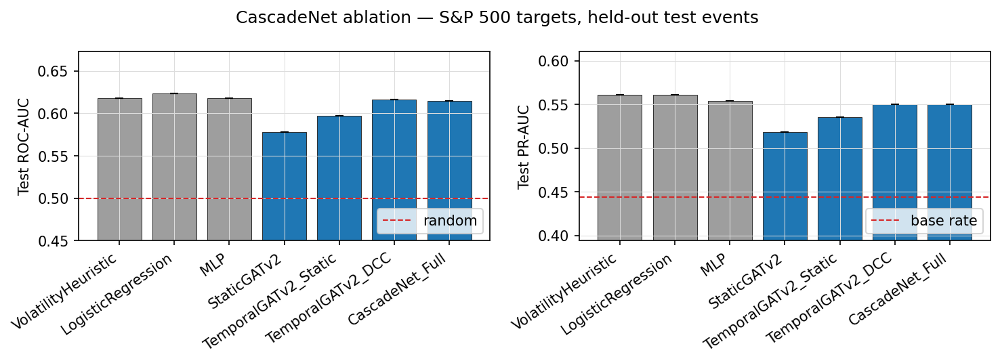

# Financial Shock Prediction with Graph Neural Networks

When one stock has an abnormal move, which other stocks also make a large move soon after?
This project frames that question as **node classification on a stock graph** and tests,
on held-out *later* events, whether graph neural networks beat simple baselines.

It contains:

- **Finance-sector GATv2.** A 2-layer GATv2 over 10 large US banks, with documented peer
  links and a 1-day horizon. This is the original capstone model, re-evaluated without
  look-ahead and served by a Streamlit demo.
- **Multi-market temporal GNN.** A temporal GNN over 194 stocks in 4 markets (S&P 500, NIFTY 50,
  FTSE 100, Nikkei 225). It uses 12 weekly graph snapshots, DCC-GARCH dynamic-correlation
  edges and transformer attention over time, plus a 4-step ablation.

**Bottom line:** neither model beats a one-line volatility heuristic on held-out events.
See [Results](#results) and [Limitations](#limitations). The evaluation pipeline is the main
deliverable: it uses chronological splits, trailing-only features, DCC fitted on training
data only, multiple seeds and non-graph baselines.

---

## Publication

The finance-sector model was presented as *"A Feature-Enhanced Graph Attention Network for
Financial Shock Prediction"* at the 4th International Conference on Intelligent Cyber Physical
System and Internet of Things (ICoICI-2026, IEEE / IEEE SMC), JCT College of
Engineering and Technology, Coimbatore, 1–3 September 2026.

---

## Quick start

```bash
python -m venv .venv && source .venv/bin/activate
pip install -r requirements.txt

pytest                                          # 18 tests, ~10 s

python -m experiments.run_static_comparison     # finance sector, ~5 min, trains the app model
python -m experiments.run_ablation              # multi-market ablation, see note below
python -m experiments.generate_figures          # figures from the saved results

streamlit run app.py                            # demo (needs trained_models/finance_gatv2.pth)
```

Run every command from the repository root. The first run downloads prices from Yahoo
Finance for a fixed window (2021-10-01 → 2026-09-29) and caches them in `data/.cache/`.
The multi-market dataset (DCC-GARCH fit and graphs) is cached in `data/processed/`.

The full ablation trains 25 models (5 configs × 5 seeds). On an 8-core laptop CPU, the
4-market temporal model dominates the runtime, and the whole run takes a few hours. Use
`--quick` (1 seed, 2 epochs) for a smoke test and `--workers N` to set parallelism.

Trained checkpoints and result files are committed, so `streamlit run app.py` and
`generate_figures` work without retraining.

---

## Problem setup

For a shock at stock *s* on day *d*, predict for every other stock *i*:

```
y_i = 1  if  |P_i(d + h) / P_i(d) − 1| > 3%
```

A **shock** is a daily return whose z-score exceeds 3 against the stock's trailing 60-day
volatility (the multi-market experiment additionally requires |return| > 3%). At most 3 shocks are kept per
day. Events are split **by date** into 60% train, 20% validation and 20% test, with an
*h*-day gap between splits.

| | Finance sector | Multi-market ablation |
|---|---|---|
| Stocks | 10 US banks | 194 (50 S&P 500, 49 NIFTY, 46 FTSE, 49 Nikkei) |
| Horizon *h* | 1 day | 5 days |
| Graph | peer links + star from the shock source | top-10 \|correlation\| neighbours (Pearson or DCC) |
| Input | one snapshot | 12 snapshots, 5 trading days apart |
| Events (train / val / test) | 88 / 38 / 30 | 1162 / 378 / 392 |
| Test period | 2025-10-10 → 2026-09-22 | 2025-11-11 → 2026-09-22 |
| Scored nodes | the 9 non-source banks | S&P 500 stocks except the source |

Architecture and data-flow details: [ARCHITECTURE.md](ARCHITECTURE.md).
Temporal model math: [docs/TEMPORAL_GATV2_DESIGN.md](docs/TEMPORAL_GATV2_DESIGN.md).

---

## Results

All numbers are on the **test events**. Trained models report mean ± std over 5 seeds.
Early stopping and the F1 threshold use the validation split only. A random scorer gets
ROC-AUC 0.5 and PR-AUC equal to the base rate.

### Finance sector (10 banks, 1-day horizon)

Test set: 30 events, 270 scored stock-events, base rate 0.093 (25 positives).

| Model | ROC-AUC | PR-AUC | F1 |
|---|---|---|---|
| Volatility heuristic | 0.516 | 0.102 | 0.000 |
| Logistic regression | 0.385 | 0.086 | 0.065 |
| MLP (no graph) | 0.359 ± 0.026 | 0.077 ± 0.007 | 0.053 ± 0.048 |
| **GATv2** | **0.553 ± 0.022** | **0.114 ± 0.011** | 0.049 ± 0.052 |
| GAT (v1) | 0.529 ± 0.023 | 0.108 ± 0.008 | 0.048 ± 0.047 |
| GCN | 0.464 ± 0.032 | 0.089 ± 0.008 | 0.043 ± 0.055 |
| GraphSAGE | 0.492 ± 0.071 | 0.092 ± 0.014 | 0.021 ± 0.028 |

GATv2 ranks first, but all models are close to chance. The test set has only 25 positives,
too few to separate the models reliably. The non-graph models score *below* 0.5, so
whatever they learned from 2022–2024 reversed in 2025–26.

### Multi-market ablation (S&P 500 targets, 5-day horizon)

> **Preliminary.** These numbers come from a short run (1 seed, 3 epochs per model), not the
> full 5-seed protocol, which takes several hours on a laptop CPU
> (`python -m experiments.run_ablation`). Treat differences of a few points as noise.

Test set: 392 events, 19,490 scored stock-events, base rate 0.444.

| Model | ROC-AUC | PR-AUC | F1 |
|---|---|---|---|
| Volatility heuristic | 0.618 | 0.561 | 0.617 |
| Logistic regression | 0.623 | 0.561 | 0.621 |
| MLP (no graph) | 0.618 | 0.554 | 0.624 |
| StaticGATv2 (Pearson graph, 1 snapshot) | 0.578 | 0.518 | 0.615 |
| TemporalGATv2, Pearson edges | 0.597 | 0.535 | 0.616 |
| TemporalGATv2, DCC-GARCH edges | 0.616 | 0.550 | 0.617 |
| Full model (4 markets) | 0.614 | 0.550 | 0.615 |

Two patterns are already visible. Adding time (12 snapshots) recovers about 2 points over the
static GNN, and DCC-GARCH edges add about 2 more over Pearson correlations. But no graph model
beats the non-graph baselines, which matches the finance-sector result.



---

## What changed from the original capstone

The original reported **0.914 ROC-AUC / 0.80 F1** for the finance GATv2. That number did not
hold up:

| Problem | Effect | Fix |
|---|---|---|
| 0.914 was the best of 1,080 hyperparameter configs, scored on a 12-sample validation set | selection bias; retraining the same config gave 0.69 and 0.76 | separate test split, 5 seeds, mean ± std |
| events were listed by ticker before the "temporal" 80/20 split | training and validation overlapped in time | sort events by date, purge gap between splits |
| shock z-scores used full-sample mean/std | used future data to define events | trailing 60-day volatility |
| the app ran the 10-bank model on 60 stocks, with a different graph and 3-month features | outputs didn't correspond to the trained model | app uses the training feature/graph code and the 10-bank universe |
| the app's network page added random "competitor gains"; predictions fell back to a correlation heuristic | displayed numbers weren't model output | removed |
| the multi-market ablation trained on synthetic data, even in `run_real_ablation.py` | ablation numbers were meaningless (AUC ≈ 0.47) | real 4-market event dataset (`data/shock_dataset.py`) |
| paper figures fell back to hard-coded metrics and random data | figures could show numbers nobody measured | figures are built from saved results only |
| DCC-GARCH optimizer accepted an infeasible penalty point | constant correlations | grid warm start + composite likelihood for N > 20 |

---

## Repository layout

```
app.py                         Streamlit demo (finance-sector GATv2)
data/
  multi_market.py              tickers, yfinance download/cache, USD panel on NYSE calendar
  dynamic_correlation.py       DCC-GARCH estimator (fit on train, filter forward)
  shock_dataset.py             multi-market events, features, labels, Pearson/DCC graphs, splits
  finance_universe.py          finance-sector events, 8 features, peer graph (shared with the app)
models/
  temporal_gatv2.py            TemporalGATv2 (spatial GATv2 + temporal transformer)
  baselines.py                 StaticGATv2, GAT, GCN, GraphSAGE, MLP
experiments/
  training.py                  training loop, metrics, threshold selection
  run_static_comparison.py     finance-sector experiment
  run_ablation.py              multi-market ablation
  generate_figures.py          figures from saved results
  results/  figures/           outputs (committed)
analysis/attention_attribution.py   temporal / edge attention diagnostics
trained_models/                checkpoints (app model + seed-0 ablation models)
paper/main.tex                 write-up
tests/                         pytest suite (look-ahead, splits, shapes, training)
```

---

## Limitations

- **Small, single-regime test sets.** The finance test set has 25 positives. The multi-market
  test covers about 10 months. Both are one draw from one market regime, and results could
  differ in another period.
- **The label is dominated by volatility.** "Moves more than 3%" is mostly about how volatile
  a stock already is, which is why the volatility heuristic is hard to beat. A label based on
  abnormal returns (net of market or sector moves) would isolate propagation better.
- **Survivorship and look-back universe.** Constituents are today's large caps, and tickers
  that failed to download (e.g. delisted ones) are dropped.
- **Yahoo Finance data.** Adjusted prices can be revised, so a fresh download may not exactly
  reproduce the cached data.
- **Hyperparameters were not tuned for the multi-market model.** They follow the design doc. A validation
  search might help, but it was out of scope.
- **Attention is not causation.** The attention figures show what the model weighted, not
  contagion paths.

This is a research project, not investment advice.
